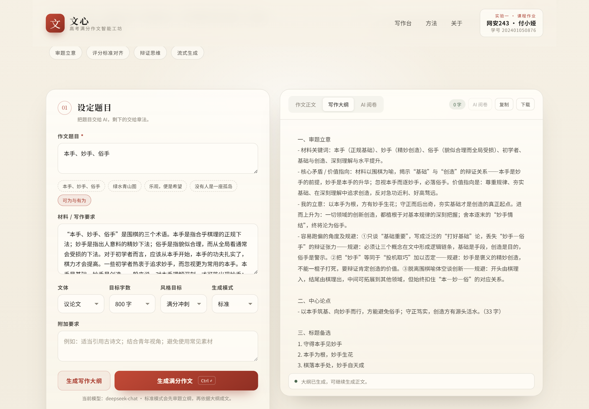
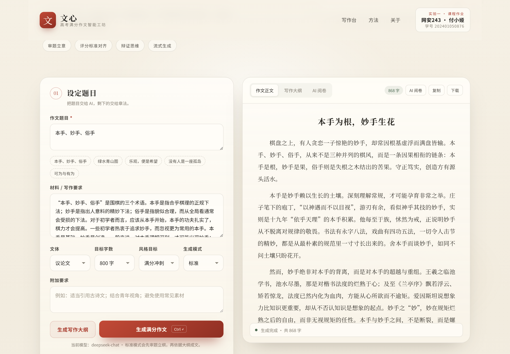
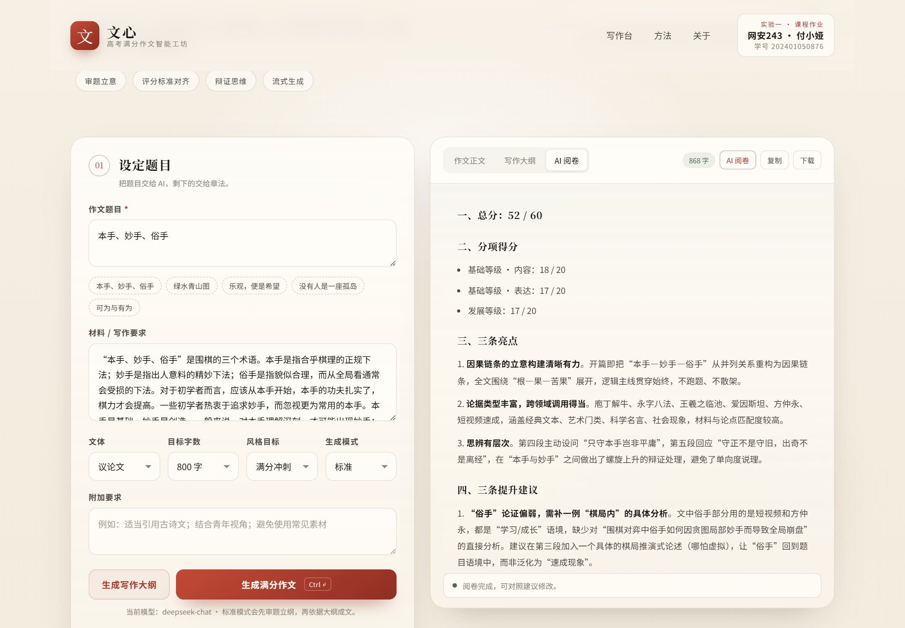
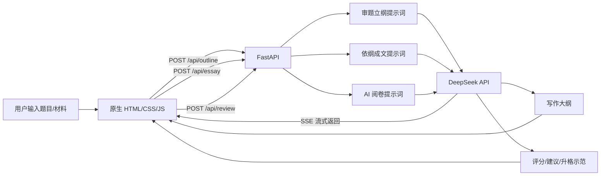

# 文心 · 高考满分作文智能工坊

> 《生成式人工智能》课程实验一：基于提示工程的智能应用  
> **班级：网安243　姓名：付小娅　学号：202401050876**

「文心」是一个包含 Web 界面的高考作文智能生成应用。用户输入作文题目与材料，系统先审题立纲，再依据大纲生成一篇结构完整、立意明确、语言有文采的考场作文；生成后还可以让 AI 按新高考评分标准阅卷，给出分项得分、亮点、提升建议与升格示范。

技术栈：**FastAPI + OpenAI SDK + DeepSeek + SSE 流式输出 + 原生 HTML/CSS/JavaScript**。

---

## 一、功能特性

- **两阶段提示工程**：先审题立纲，再依纲成文，降低跑题与结构松散的风险。
- **评分标准对齐**：把基础等级（内容 20 + 表达 20）与发展等级（20）写进提示词。
- **流式生成**：正文通过 SSE 逐字输出，生成过程可见、可停止。
- **AI 阅卷**：按 60 分制给出总分、分项得分、三条亮点、三条建议与升格示范。
- **多种文体与风格**：议论文、记叙文、议论性散文、书信体；满分冲刺、稳健高分、思辨深刻、文采斐然。
- **本地历史记录**：最近 8 篇作文保存在浏览器 localStorage，可一键载入。
- **复制与下载**：正文、大纲、点评均可复制或下载为 txt。
- **响应式布局**：桌面端双栏写作台，移动端自动堆叠。
- **演示模式**：未配置 API Key 时自动使用内置示例，方便课堂演示与截图。

## 二、运行效果

以下截图均为真实调用 DeepSeek `deepseek-chat` 的运行效果。

### 1. 系统首页


首页包含产品介绍、写作台入口，以及**班级、姓名、学号**信息（网安243 · 付小娅 · 202401050876）。

### 2. 审题立纲



选择示例题目「本手、妙手、俗手」后点击“生成写作大纲”，系统输出审题立意、中心论点、标题备选、结构提纲、素材名言与写作提醒。大纲会展示在右侧“写作大纲”标签页。

### 3. 依纲成文



点击“生成满分作文”，正文通过 SSE 流式输出。顶部实时显示字数，可复制、下载；生成结果自动进入左下角“最近生成”历史记录。示例生成《本手为根，妙手生花》，约 868 字。

### 4. AI 阅卷



点击“AI 阅卷”，系统按新高考评分标准给出总分、分项得分、三条亮点、三条提升建议和升格示范。示例作文得分 **52 / 60**（内容 18/20、表达 17/20、发展等级 17/20）。

### 5. 移动端适配


移动端自动切换为单栏布局，表单、输出区、功能按钮均可用。

## 三、快速开始

### 1. 环境要求

- Python 3.10+（本项目在 Python 3.14 下测试通过）
- 一个 DeepSeek API Key（或其他 OpenAI 兼容接口）
- 无需 Node.js，前端由 FastAPI 直接托管

### 2. 安装依赖

```bash
git clone https://github.com/AKCCccc/lab1-gaokao-essay.git
cd lab1-gaokao-essay

python -m venv .venv

# Windows
.venv\Scripts\activate
# macOS / Linux
source .venv/bin/activate

pip install -r requirements.txt
```

### 3. 配置环境变量

复制 `.env.example` 为 `.env`：

```bash
# Windows
copy .env.example .env
# macOS / Linux
cp .env.example .env
```

填写 DeepSeek API Key：

```ini
DEEPSEEK_API_KEY=sk-xxxxxxxxxxxxxxxxxxxxxxxxxxxxxxxx
OPENAI_BASE_URL=https://api.deepseek.com
MODEL_NAME=deepseek-chat
DEMO_MODE=false
TEMPERATURE=0.8
MAX_TOKENS=2600
```

> `.env` 已写入 `.gitignore`，不会提交到仓库。请不要把真实 Key 写进 README 或前端代码。

### 4. 启动服务

```bash
uvicorn app.main:app --reload --host 127.0.0.1 --port 8000
```

浏览器打开 <http://127.0.0.1:8000>。

### 5. 演示模式

如果没有 API Key，或课堂演示时不想消耗额度，可设置：

```ini
DEMO_MODE=true
```

系统会使用 `app/demo.py` 中的内置大纲、作文与点评，页面流程与真实调用完全一致。

## 四、项目结构

```text
lab1-gaokao-essay/
├─ app/
│  ├─ __init__.py
│  ├─ main.py          # FastAPI 入口与接口
│  ├─ config.py        # 环境变量配置
│  ├─ models.py        # Pydantic 请求模型
│  ├─ llm.py           # OpenAI SDK 封装（普通调用 + 流式）
│  ├─ prompts.py       # 核心提示词（提示工程重点）
│  └─ demo.py          # 演示模式内容
├─ static/
│  ├─ index.html       # 单页应用
│  ├─ styles.css       # 视觉样式与响应式布局
│  ├─ app.js           # 交互、SSE 解析、历史记录
│  └─ favicon.svg
├─ scripts/
│  ├─ smoke_test.py    # 演示模式冒烟测试
│  └─ make_screenshots.py
├─ docs/
│  └─ prompts.md       # 提示词工程说明与完整提示词
├─ screenshots/        # README 截图
├─ requirements.txt
├─ requirements-dev.txt
├─ .env.example
├─ .gitignore
└─ README.md
```

## 五、技术架构



生成流程：

1. 前端收集题目、材料、文体、字数、风格与附加要求。
2. `/api/outline` 调用大纲提示词，返回结构化写作大纲。
3. `/api/essay` 把大纲与评分标准一起送入正文提示词，通过 SSE 流式返回作文。
4. `/api/review` 按评分标准对作文进行点评。

## 六、API 说明

| 方法 | 路径 | 说明 |
| --- | --- | --- |
| GET | `/api/health` | 健康检查，返回模型名、接口地址、是否演示模式 |
| POST | `/api/outline` | 生成写作大纲 |
| POST | `/api/essay` | 生成作文正文，`text/event-stream` 流式返回 |
| POST | `/api/review` | AI 阅卷点评 |
| GET | `/` | 返回前端页面 |

### 生成请求示例

```bash
curl -X POST http://127.0.0.1:8000/api/outline \
  -H "Content-Type: application/json" \
  -d '{
    "title": "本手、妙手、俗手",
    "material": "本手是基础，妙手是创造。",
    "genre": "议论文",
    "word_count": 800,
    "style": "满分冲刺",
    "extra": "适当引用古诗文",
    "mode": "standard"
  }'
```

### SSE 事件格式

```text
data: {"type": "start", "demo": false}

data: {"type": "delta", "content": "棋"}

data: {"type": "done", "word_count": 868, "demo": false}
```

出错时返回：

```text
data: {"type": "error", "message": "调用大模型失败：..."}
```

## 七、提示词工程

完整的提示词设计、策略对照与迭代记录见 **[docs/prompts.md](docs/prompts.md)**，代码实现见 `app/prompts.py`。

### 核心策略

| 策略 | 具体做法 | 目的 |
| --- | --- | --- |
| 角色扮演 | 设定为“特级教师 + 高考阅卷组组长” | 锚定专业表达，减少口语化 |
| 标准对齐 | 写入基础等级 40 分 + 发展等级 20 分 | 让生成目标与阅卷标准一致 |
| 任务分解 | 大纲与正文分成两次调用 | 降低跑题、结构松散风险 |
| 结构化输出 | 大纲固定字段；阅卷固定结构 | 输出稳定，便于解析展示 |
| 显式约束 | 字数、段数、开头、结尾、辩证段、素材、禁忌 | 把“写得好”变成可执行规则 |
| 风格锚点 | 提供高分范文片段，注明“严禁照抄” | 学其气韵，避免模板化 |
| 隐式自检 | 动笔前按评分标准自检，但不输出过程 | 提升切题度与完成度 |
| 温度分层 | 大纲 0.7、正文 0.8、阅卷 0.3 | 兼顾创意与稳定 |

### 系统提示词摘要

```text
你是一位深耕高中语文教学与高考阅卷二十余年的特级教师，长期担任高考作文阅卷组组长……

【评分标准内化】
- 基础等级（40 分）：内容（20 分）……表达（20 分）……
- 发展等级（20 分）：深刻、丰富、有文采、有创意……

【写作铁律】
1. 审题第一：准确提炼核心矛盾与价值指向，立意不偏、不泛、不套作。
2. 结构清晰：分论点之间有逻辑递进，不并列堆砌。
3. 材料鲜活：事实准确，优先使用具体、有细节、少被滥用的素材。
4. 语言有文采：长短句结合，适当运用排比、比喻、引用、对比。
5. 文体纯粹：不写成“四不像”。
6. 标题出彩：8—14 字，含蓄凝练，能统摄全文。
7. 严禁：套作宿构、网络烂梗、假大空口号、无逻辑材料罗列。

【输出纪律】
- 只输出要求的内容，不解释写作思路，不输出 Markdown 围栏。
- 作文正文自然分段，标题单独一行。
```

## 八、测试

演示模式冒烟测试（不消耗 API 额度）：

```bash
python scripts/smoke_test.py
```

覆盖：健康检查、大纲接口、SSE 流式正文、阅卷接口、首页个人信息。

重新生成 README 截图（需要本机 Chrome 或 Edge，会真实调用模型）：

```bash
pip install -r requirements-dev.txt
python scripts/make_screenshots.py
```

## 九、配置项

| 变量 | 默认值 | 说明 |
| --- | --- | --- |
| `DEEPSEEK_API_KEY` | 空 | DeepSeek 或其他 OpenAI 兼容服务的 Key |
| `OPENAI_BASE_URL` | `https://api.deepseek.com` | OpenAI 兼容接口地址 |
| `MODEL_NAME` | `deepseek-chat` | 模型名称 |
| `DEMO_MODE` | 无 Key 时为 true | 是否使用内置演示内容 |
| `TEMPERATURE` | `0.8` | 正文生成温度 |
| `MAX_TOKENS` | `2600` | 单次生成最大 token 数 |

## 十、实验要求完成情况

| 要求 | 完成情况 |
| --- | --- |
| 包含 Web 界面的智能应用 | ✅ 原生 HTML/CSS/JS 单页应用 |
| 后台使用 FastAPI | ✅ `app/main.py` |
| 调用大模型使用 OpenAI SDK | ✅ `app/llm.py` |
| 总结范文规律并应用提示工程 | ✅ `app/prompts.py` + `docs/prompts.md` |
| 首页包含班级、姓名、学号 | ✅ 网安243 · 付小娅 · 202401050876 |
| README 包含运行说明与功能截图 | ✅ 本文档 |
| README 转换为 docx | ✅ `README.docx` |
| 核心提示词 | ✅ 见 `docs/prompts.md` 与本文第七节 |
| 多用户信息管理系统（可选） | ⬜ 未实现，使用浏览器本地历史记录 |
| Vercel 部署（可选） | ⬜ 未部署，项目可直接运行于 Render / Railway / 云服务器 |

## 十一、安全与说明

- API Key 只从 `.env` 读取，`.env` 已被 `.gitignore` 忽略，不会进入版本库。
- 后端对请求字段做了长度与取值范围校验，避免异常超长输入。
- 生成内容仅供写作学习与课堂演示参考，请勿直接用于考试。
- 若出现 `401 Authentication Fails`，请检查 Key 是否为 DeepSeek 官方 `sk-` 开头的有效 Key。

## 十二、提交信息

- 课程：生成式人工智能 · 实验一
- 班级：网安243
- 姓名：付小娅
- 学号：202401050876
- GitHub 仓库：<https://github.com/AKCCccc/lab1-gaokao-essay>
